

  
  <h1 align="center">Browsers</h1>
  <h3 align="center">Open the right browser at the right time</h3>
  <h3 align="center">For Linux, Mac and Windows</h3>

## Description

Browsers is an intuitive context menu that pops up when you press a link in an app other than a web browser.

**See our website for download links and instructions** 
**https://browsers.software**

  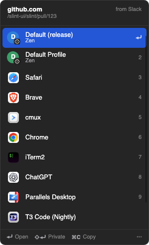
  &nbsp;&nbsp;
  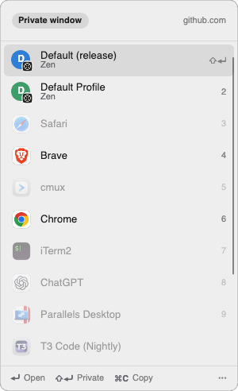

### The picker

- **Shows up instantly.** Browsers keeps running quietly in the background, so the picker appears as soon as you click a link (you can turn this off in Settings).
- **Shows where the link goes:** the domain, the path, and which app it came from.
- **Profile-first rows:** each browser profile gets its own row, with a small badge showing its browser.
- **Keyboard first:**
  - <kbd>↑</kbd>/<kbd>↓</kbd> and <kbd>↵</kbd> to pick, <kbd>1</kbd>–<kbd>9</kbd> to jump.
  - Type to filter, <kbd>⌘C</kbd> to copy the link.
  - Hold <kbd>⇧</kbd> to open in a private window.
- **Right-click a row** to open it privately, copy the link, **always open this site here** (creates a rule), hide the app, or manage browsers.

  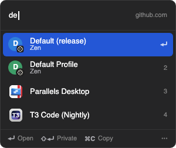
  &nbsp;&nbsp;
  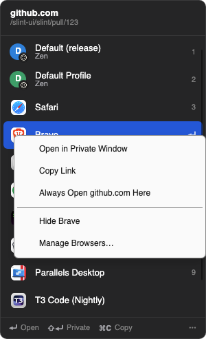

### Settings

**Browsers:**
- Drag to reorder, which is also the order in the picker.
- Hide or show any app or profile with the eye button.
- Profiles are grouped under their browser.
- Browsers offers to hide the apps it found that aren't web browsers.

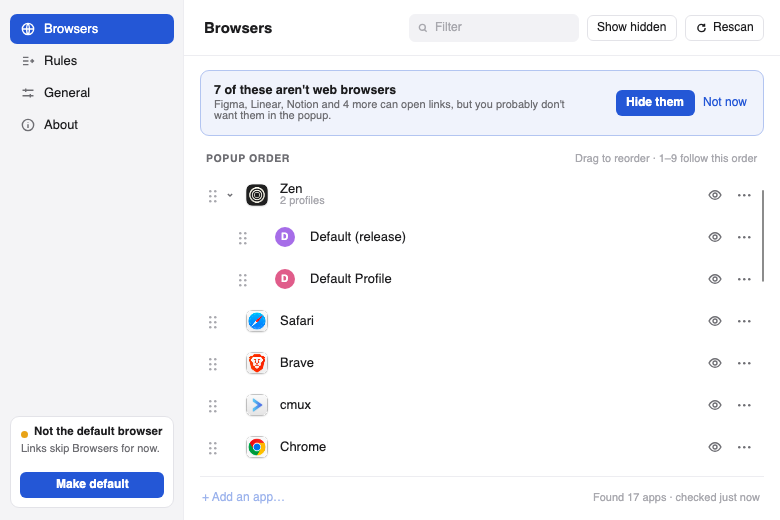

**Rules:**
- Send links to a specific browser or profile automatically, by site, by the app the link came from, or both.
- Paste a link into **Test a link** to see which rule would catch it.
- Rules run top to bottom, and you drag them to change the order.

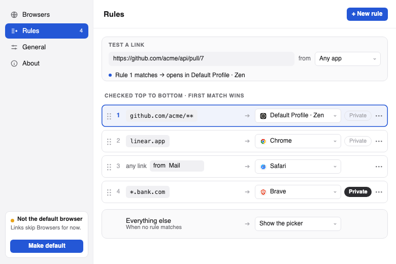

More screenshots

| | |
|---|---|
| 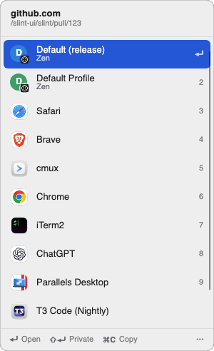 | 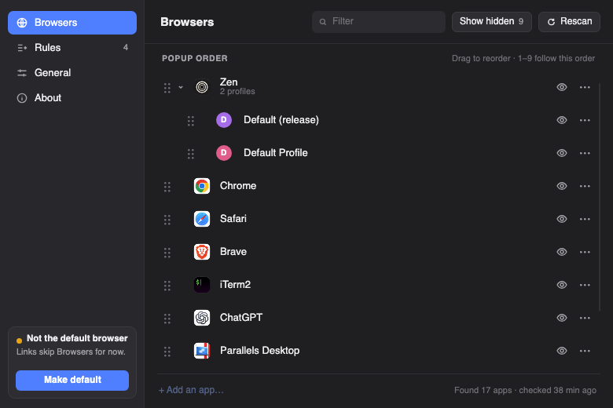 |
| 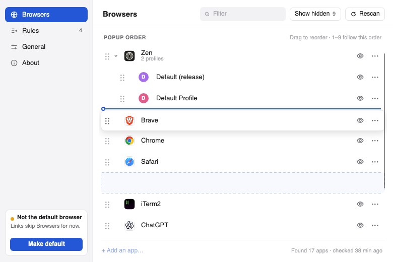 | 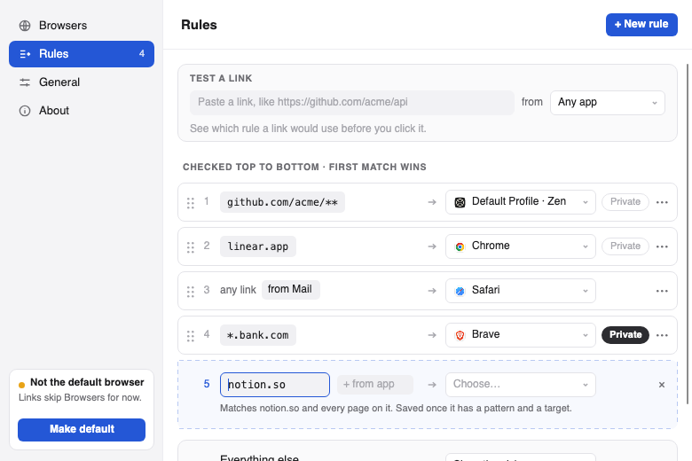 |
| 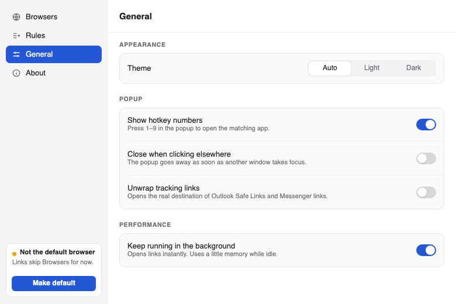 | |

### Special Skills

- Non-obtrusive design, looking more like a context menu
- Supports opening popular desktop applications directly, e.g Figma, Linear, Notion, Slack, Spotify, Telegram, Zoom.
- Supports user profiles for browsers based on Chrome and Firefox
- Supports Firefox containers (also
  need [Open external links in a container](https://addons.mozilla.org/en-US/firefox/addon/open-url-in-container/)
  extension installed until [#1726634](https://bugzilla.mozilla.org/show_bug.cgi?id=1726634) is resolved)

### Technical Special Skills

- Starts fast, and is instant when it's running in the background (macOS, on by default). Turn "Keep running in the background" off in Settings to have it quit after every link.
- Remembers the apps it found, so it doesn't scan your disk every time you click a link.
- Runs on Mac, Linux and Windows

### Developing

See [DEVELOPING.md](DEVELOPING.md) for running a dev build next to your installed copy.

### Download

Download for your platform

- macOS
  - To stay up with latest releases, install via homebrew:

        brew install --cask browsers-software/tap/browsers

  - [**Browsers.dmg**](https://github.com/Browsers-software/browsers/releases/latest/download/Browsers.dmg) (Apple Silicon and Intel based Macs)
- Linux
  - DEB package
    - [**browsers_amd64.deb**](https://github.com/Browsers-software/browsers/releases/latest/download/browsers_amd64.deb) (x86_64)
    - [**browsers_arm64.deb**](https://github.com/Browsers-software/browsers/releases/latest/download/browsers_arm64.deb) (arm64)
    - [**browsers_armhf.deb**](https://github.com/Browsers-software/browsers/releases/latest/download/browsers_armhf.deb) (armv7l)
  - RPM package
    - [**browsers.x86_64.rpm**](https://github.com/Browsers-software/browsers/releases/latest/download/browsers_x86_64.deb) (x86_64)
    - [**browsers.aarch64.rpm**](https://github.com/Browsers-software/browsers/releases/latest/download/browsers_aarch64.deb) (arm64)
    - [**browsers.armhfp.rpm**](https://github.com/Browsers-software/browsers/releases/latest/download/browsers_armhfp.deb) (armv7l)
  - Universal - [**browsers_linux.tar.gz**](https://github.com/Browsers-software/browsers/releases/latest/download/browsers_linux.tar.gz) (x86_64, arm64 and armv7l)
  - Nix - [#130](https://github.com/Browsers-software/browsers/issues/130)
  - AUR - [browsers-bin](https://aur.archlinux.org/cgit/aur.git/tree/PKGBUILD?h=browsers-bin) and [browsers-git](https://aur.archlinux.org/cgit/aur.git/tree/PKGBUILD?h=browsers-git)
- Windows - [**Browsers_windows.zip**](https://github.com/Browsers-software/browsers/releases/latest/download/Browsers_windows.zip) (x86_64 and arm64)

## Social

* [@BrowsersTweets](https://twitter.com/BrowsersTweets) on Twitter

## License

Browsers is free and open source! All code in this repository is dual-licensed under either:

* MIT License ([LICENSE-MIT](LICENSE-MIT) or [http://opensource.org/licenses/MIT](http://opensource.org/licenses/MIT))
* Apache License, Version 2.0 ([LICENSE-APACHE](LICENSE-APACHE)
  or [http://www.apache.org/licenses/LICENSE-2.0](http://www.apache.org/licenses/LICENSE-2.0))

at your option. This means you can select the license you prefer!

Unless you explicitly state otherwise, any contribution intentionally submitted for inclusion in the work by you, as
defined in the Apache-2.0 license, shall be dual licensed as above, without any additional terms or conditions.

## Supporters

- JetBrains provides us a free open-source license for their IDEs